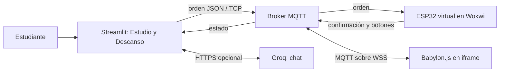

# Guarida: simulación de un cubículo inteligente de estudio

**Enlaces de entrega actualizados el 12 de noviembre de 2026:** [repositorio GitHub privado](https://github.com/Jhuza/Guarida) · [simulación Wokwi pública](https://wokwi.com/projects/480507284209602561). Pendientes: acceso del evaluador al repositorio y despliegue de Streamlit. Los resultados y limitaciones del informe deben leerse con esta actualización de publicación.

**Autor:** Juan José Hoyos · **Asignatura:** Interfaces Multimodales
**Versión:** primera entrega técnica revisable · **Fecha:** 9 de noviembre de 2026
**Institución y docente:** completar antes de entregar.

## 1. Resumen

Guarida es un prototipo de cubículo de estudio que integra organización de tareas, temporización y representación de disponibilidad. La aplicación utiliza Streamlit para sus páginas Estudio y Descanso, Babylon.js para representar el espacio y MQTT para comunicarse con un ESP32 simulado en Wokwi. Permite interacción mediante texto, controles gráficos y comandos de voz, con respuestas visuales y sonoras. Se ha comprobado la comunicación en ambas direcciones con el circuito simulado. El asistente conversacional dispone de una integración opcional con Groq, pendiente de activación y validación con una clave del usuario. La propuesta parte de observaciones personales; no constituye un estudio validado de hábitos ni una intervención de eficacia demostrada.

## 2. Introducción, problema y objetivos

### Problema

Comenzar una tarea académica no siempre implica saber cómo abordarla. La persona de referencia reconoce una obligación, pero no define un resultado concreto ni un primer paso. Mantiene el celular cerca ante la posibilidad de una emergencia; las notificaciones y el acceso inmediato a redes terminan desplazando el tiempo de trabajo. Abrir numerosas herramientas y pestañas aumenta su sensación de carga y dificulta decidir por dónde empezar.

También refiere dificultades para gestionar descansos: una pausa breve puede prolongarse al usar el celular o conversar. Prefiere espacios silenciosos, con poco tránsito y cierta privacidad. En casa, la habitación está asociada a descanso, videojuegos y ocio, por lo que no facilita separar estas actividades del estudio. Escuchar su playlist puede distraerla; percibe que ciertos sonidos binaurales le ayudan. Esta percepción personal no demuestra un efecto general sobre concentración, estrés o ansiedad.

La oportunidad de diseño es ofrecer una transición clara entre intención, acción y descanso: definir un objetivo, dividirlo en tareas y disponer de señales comprensibles sobre el estado de la sesión. Un espacio aislado, por sí solo, no enseña a estudiar. Guarida debe apoyar acciones de aprendizaje, como formular preguntas y revisar errores, además de gestionar el ambiente.

### Protopersona y límites

Protopersona provisional: estudiante o persona con responsabilidades académicas/laborales que se distrae con el teléfono, se abruma con recursos abiertos y necesita estructura y privacidad. Se construyó únicamente a partir de la opinión del autor. No se realizaron entrevistas ni encuestas; no se atribuyen edad, frecuencia de hábitos ni representatividad estadística. Otros usuarios pueden tener necesidades diferentes.

### Objetivo general

Diseñar y comprobar una simulación multimodal que permita organizar una sesión de estudio y sincronizar su estado con un cubículo virtual.

### Objetivos específicos

1. Implementar dos ambientes navegables: Estudio y Descanso.
2. Permitir definir un objetivo, editar tareas y gestionar bloques de tiempo.
3. Intercambiar órdenes y estados entre Streamlit y Wokwi por MQTT, verificando su confirmación.
4. Representar el estado del cubículo en Babylon.js y ofrecer alternativas de entrada y salida.
5. Registrar pruebas técnicas y preparar una evaluación de uso sin atribuir resultados todavía no medidos.

### Plan de trabajo: cinco fases de design thinking

| Fase | Trabajo | Entregable y situación |
|---|---|---|
| Empatizar | Recoger dificultades iniciales; después escuchar a usuarios reales. | Protopersona provisional disponible; entrevistas pendientes. |
| Definir | Precisar la dificultad de comenzar, organizar y retomar el estudio. | Problema, objetivos y alcance de esta versión. |
| Idear | Explorar guía por objetivos, pausas y señales de disponibilidad. | Selección del flujo mínimo y funciones futuras separadas. |
| Prototipar | Construir Streamlit, circuito virtual, MQTT y escena 3D. | Código ejecutable y asistente opcional. |
| Evaluar | Probar integración, errores y tareas con participantes. | Pruebas técnicas realizadas; evaluación con personas pendiente. |

## 3. Marco teórico

**Interacción multimodal.** La arquitectura de interacción multimodal del W3C plantea componentes con interfaces definidas y coordinación de modalidades [1]. En Guarida, texto, controles y voz proporcionan entradas alternativas; pantalla, escena y sonido ofrecen salidas. No todas las modalidades tienen que operar simultáneamente, y las funciones principales deben conservar una alternativa por botones.

**Estudio activo.** El Learning Center de UNC describe prácticas como explicar ideas, elaborar preguntas y organizar el trabajo, frente a limitarse a releer [2]. Guarida incorpora una lista editable y una guía que puede sugerir acciones concretas. Su presencia en la aplicación no demuestra que el usuario aprenda más: eso requeriría otra evaluación.

**Organización temporal.** El prototipo propone bloques ajustables de estudio y descanso, inicialmente 25 y 5 minutos. Son valores de diseño inspirados en una organización tipo Pomodoro, no intervalos universalmente óptimos ni una obligación. El usuario puede pausar, continuar o terminar.

**MQTT.** MQTT utiliza publicación/suscripción para desacoplar emisores y receptores. La entrega QoS 1 puede duplicar mensajes [3]. Guarida asigna identificadores a las órdenes y exige una respuesta correspondiente para confirmar el cambio. La confirmación de transporte no sustituye la confirmación de aplicación emitida por Wokwi.

**Representación 3D.** Babylon.js aporta la representación interactiva del cubículo en el navegador [4]. Es una vista del estado comunicado, mientras que el firmware ejecuta la lógica del dispositivo simulado. No sustituye el circuito requerido por la rúbrica.

## 4. Requerimientos y casos de uso

| ID | Requerimiento | Criterio de aceptación |
|---|---|---|
| RF01 | Navegar entre dos ambientes. | Se abren Estudio y Descanso con controles propios. |
| RF02 | Definir un objetivo y organizar tareas. | Un objetivo vacío se rechaza; las tareas pueden editarse y marcarse. |
| RF03 | Solicitar un estado del cubículo. | La app distingue orden enviada de respuesta confirmada con igual id y estado. |
| RF04 | Recibir cambios iniciados en Wokwi. | Un botón simulado actualiza Streamlit y la escena. |
| RF05 | Gestionar tiempos. | Iniciar desde Streamlit espera confirmación; pausa, reanudación y fin funcionan. |
| RF06 | Usar modalidades alternativas. | Texto y botones están disponibles; voz informa si no es compatible. |
| RF07 | Mostrar fallos y evidencia. | Se indica falta de confirmación/conexión/señal y se pueden descargar mensajes. |
| RF08 | Conversar con IA opcional. | Con clave válida responde; sin clave o ante error conserva la guía manual. Prueba real pendiente. |
| RNF01 | Separar componentes. | Firmware, lógica, conexión, IA y escena están en archivos independientes. |
| RNF02 | Proteger credenciales. | La clave solo se lee en el servidor desde entorno/secretos; no va al navegador ni a MQTT. |
| RNF03 | Informar el estado con texto. | Los cambios no dependen únicamente del color. |
| RNF04 | Facilitar reproducción. | Versiones Python fijadas, instrucciones, circuito y pruebas disponibles. |

**CU01 — Preparar sesión:** el estudiante escribe un objetivo, genera la guía inicial, concreta sus tareas y solicita concentración. Si no hay conexión, se informa; no se inicia el contador como si el dispositivo hubiera confirmado.

**CU02 — Cambiar desde el cubículo:** el estudiante pulsa Descanso en Wokwi. El firmware actualiza OLED y publica su estado; Streamlit y Babylon lo reciben. Este cambio de disponibilidad no inicia automáticamente el temporizador de la aplicación.

**CU03 — Descansar:** el estudiante abre Descanso y solicita un bloque ajustable. Tras confirmación, comienza la cuenta. Puede pausar o terminar y volver a estudiar.

**CU04 — Pedir orientación:** con Groq configurado, el estudiante envía una pregunta. La respuesta queda en el chat y puede orientar la edición manual de tareas. La IA no controla el hardware ni inicia temporizadores.

**CU05 — Recuperarse de un fallo:** si Wokwi se detiene, se identifica la ausencia de señal. Si falla la IA, un mensaje indica el problema y las tareas siguen disponibles.

## 5. Arquitectura del sistema

El broker de demostración es `broker.hivemq.com`. Python y Wokwi usan TCP 1883; el navegador utiliza WSS 8884 y ruta `/mqtt`. MQTT.js requiere transporte WebSockets en navegador [5]. La sala identifica los temas `guarida/{room}/command` y `guarida/{room}/state`.

Una orden incluye `v`, `id` y `state`. El estado incluye además `source`, `cause`, `boot` y `uptime`. Los estados aceptados son `concentracion`, `descanso` y `disponible`. Solo la respuesta con id y estado correspondientes satisface una solicitud pendiente. Se ignoran estados retenidos para no tratarlos como prueba de presencia. Después de ocho segundos se muestra una orden sin confirmar; quince segundos sin estados se consideran falta de señal reciente.

La simulación puede ejecutar su reloj más lento que el tiempo real. Esto influye en el intervalo observable de heartbeat y debe comprobarse en la conexión de clase. El broker público no autentica a los participantes: los nombres de sala no son contraseñas. Se usa únicamente para estados de demostración, sin objetivos, audio, claves ni conversaciones.

## 6. Hardware simulado en Wokwi

| Componente | Conexión/función |
|---|---|
| ESP32 DevKit C V4 virtual | Wi-Fi Wokwi-GUEST y cliente MQTT. |
| OLED SSD1306 128 × 64 | SDA GPIO21, SCL GPIO22, alimentación 3V3 y GND, dirección 0x3c. |
| Botón azul | GPIO25 a GND: concentración. |
| Botón amarillo | GPIO26 a GND: descanso. |
| Botón verde | GPIO27 a GND: disponible. |

Los botones usan `INPUT_PULLUP` y antirrebote de 40 ms. El firmware valida órdenes, actualiza la pantalla, responde con el identificador recibido y publica heartbeat cada cuatro segundos del reloj simulado. La reconexión MQTT se reintenta periódicamente. Las bibliotecas requeridas están en `wokwi/libraries.txt`; el cableado se conserva en `diagram.json` [6–8].

No se necesita comprar ni conectar un ESP32 físico. La versión actual no implementa climatización, cerradura, huella, smart glass ni tira WS2812B.

## 7. Aplicación Streamlit y modalidades

**Estudio:** objetivo, lista inicial por reglas, edición de una a ocho tareas, progreso, descarga de resumen, temporizador, estado del dispositivo, escena 3D y chat opcional. **Descanso:** bloque de pausa ajustable, temporizador y retorno a concentración. Los fragmentos de Streamlit actualizan periódicamente el contador y la recepción sin reconstruir toda la página [9].

| Modalidad | Implementación | Necesidades y límites |
|---|---|---|
| Texto | Objetivo, tareas y chat opcional. | Teclado; Groq requiere internet y clave propia. |
| Controles gráficos | Botones, navegación, casillas, duración. | Navegador y ratón/táctil/teclado. |
| Voz de entrada | Comandos concentración, descanso y disponible. | SpeechRecognition compatible y permiso de micrófono; pendiente validación humana. No es conversación de audio con IA. |
| Voz de salida | Bienvenida mediante speechSynthesis. | Voz instalada/disponible; activación por el usuario. |
| Audio | Tonos de 220 y 228 Hz separados por canal. | Web Audio, salida estéreo y auriculares para separación; activación manual. No es una biblioteca musical. |
| Visual 3D | Cámara orbital, pantalla y señales de estado. | WebGL, acceso a CDN de Babylon/MQTT.js y WSS. |

El chat usa una llamada HTTPS con biblioteca estándar de Python, evitando añadir un SDK al entorno. El proveedor recomendado es Groq; la guía oficial muestra el modelo `llama-3.3-70b-versatile` y configuración mediante clave [10]. La disponibilidad y las cuotas dependen del servicio/cuenta [11]. La clave permanece fuera del repositorio. No se han hecho llamadas reales al proveedor por falta de credencial; las pruebas del adaptador usan respuestas simuladas.

## 8. Pruebas y resultados

| Prueba | Resultado registrado | Alcance |
|---|---|---|
| Suite automática, revisión actual | 17 pruebas aprobadas; dependencias sin incompatibilidades detectadas. | Protocolo, temporizador condicionado a confirmación, cancelación, interfaz, edición de tareas y adaptador IA simulado. |
| Red de prueba | Cinco comprobaciones aprobadas en la revisión previa. | Tres estados, evento independiente y WSS/TCP; dispositivo emulado en Python. |
| Orden real a Wokwi | Concentración confirmada con id `cea5778c11d742e2aa43dd16ae0cf1f6`. | Streamlit → broker → Wokwi → clientes, observado en revisión anterior. |
| Entrada real en Wokwi | Botón amarillo cambió a Descanso en ambos clientes. | Firmware, interfaz y escena. |
| Desconexión | Se observó “Sin señal reciente”. | Wokwi detenido; captura conservada. |
| Render y navegación | Dos páginas y escena visibles. | No equivale a evaluación de usabilidad. |
| Audio/voz y usuarios | Pendiente. | No hay observaciones humanas registradas. |
| IA real y despliegue público | Pendiente. | Requieren cuenta/clave y publicación. |

Las capturas `evidencia-descanso.png` y `evidencia-desconexion.png` conservan las comprobaciones anteriores. El registro de la revisión actual y el protocolo para participantes acompañan este informe. Un error temporal de compilación `Failed to fetch` en Wokwi se resolvió reintentando. No se midió una mejora de aprendizaje, concentración o ansiedad.

## 9. Conclusiones y trabajo futuro

La simulación demuestra la viabilidad de comunicar un circuito Wokwi con una aplicación multipágina y una vista 3D, diferenciando publicación y confirmación del estado. La edición de tareas y los bloques temporales materializan el flujo propuesto a partir de la protopersona. La evidencia disponible es técnica; la utilidad para estudiantes debe evaluarse con participantes.

Antes de la entrega deben guardarse y enlazarse los proyectos publicados, activar y probar la IA si se incluye en la demostración, verificar micrófono/audio, realizar las tareas de usabilidad y ensayar la sustentación. Después se abordará el diseño visual con las referencias del autor. Entre las ampliaciones se consideran conversación por audio, bienvenida flotante, otras vistas, climatización, privacidad del vidrio, acceso y luces. Ninguna se presenta como implementada.

## 10. Referencias y anexos

Fuentes técnicas consultadas para esta versión; la disponibilidad de servicios debe revisarse antes de la demostración.

1. W3C. Multimodal Architecture and Interfaces. https://www.w3.org/TR/mmi-arch/
2. UNC Learning Center. Studying 101: Study Smarter Not Harder. https://learningcenter.unc.edu/tips-and-tools/studying-101-study-smarter-not-harder/
3. OASIS. MQTT Version 3.1.1. https://docs.oasis-open.org/mqtt/mqtt/v3.1.1/os/mqtt-v3.1.1-os.html
4. Babylon.js. Features. https://doc.babylonjs.com/features/
5. MQTT.js. Browser. https://github.com/mqttjs/MQTT.js#browser
6. Wokwi. ESP32 WiFi Networking. https://docs.wokwi.com/guides/esp32-wifi
7. Wokwi. SSD1306. https://docs.wokwi.com/parts/board-ssd1306
8. Wokwi. Pushbutton. https://docs.wokwi.com/parts/wokwi-pushbutton
9. Streamlit. st.fragment. https://docs.streamlit.io/develop/api-reference/execution-flow/st.fragment
10. Groq. Quickstart. https://console.groq.com/docs/quickstart
11. Groq. Rate Limits. https://console.groq.com/docs/rate-limits

**Anexos:** README (instalación), RUBRICA_Y_PRUEBAS (matriz), VALIDACION_Y_SUSTENTACION (protocolo y guion), carpeta tests, circuito y firmware, capturas y registro de pruebas. Los enlaces públicos de repositorio, Wokwi y Streamlit se agregarán cuando estén publicados; no se inventan enlaces de entrega.
